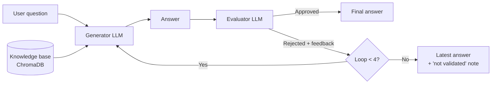

# Cellula_project3_Osama_Eslam

# Evaluator–Generator AI Platform

A question-answering platform that **checks its own answers**.
One LLM (the **Generator**) answers from your documents, a second LLM (the **Evaluator**) judges the answer, and the Generator improves it using the feedback — up to **4 times**.

## How it works



1. **Add knowledge** — upload files or give URLs. They are loaded, split into chunks, embedded, and stored in ChromaDB.
2. **Ask a question** — the Generator retrieves the most relevant chunks and answers **only from them**. If the answer isn't in the sources, it says so instead of guessing.
3. **Evaluate** — the Evaluator scores the answer (accuracy, relevance, completeness, consistency, grounding) and lists any unsupported claims.
4. **Improve** — if rejected, the feedback goes back to the Generator for a better answer.
5. **Stop** — when the answer is approved, or after 4 loops (the latest answer is returned with a warning).

## Supported knowledge sources

| Type | Formats |
|---|---|
| Documents | PDF, DOCX, TXT, PPT / PPTX |
| Source code | `.py .js .ts .tsx .jsx .java .c .cpp .cs .go .rs .rb .php .html .css` |
| Audio | WAV (transcribed to text with Whisper) |
| Web | Any web page URL, Wikipedia topic or URL |

## Key design points

- **Separate memories** — the Generator and Evaluator each have their own Redis memory (`memory:gen:<session>` and `memory:eval:<session>`). Neither agent can read the other's.
- **Redis caching** — retrieval results and answers are cached to save time and API calls. Similar questions can reuse a cached answer (semantic cache). Caches are cleared whenever the knowledge base changes, so old answers are never served.
- **Cached answers are still checked** — a cached answer only skips generation; it always goes through the Evaluator.
- **LCEL** — each loop is a LangChain LCEL chain (`generate | evaluate`); the Evaluator is a `prompt | llm | parser` chain.

## Project structure

```
app.py              Streamlit user interface
workflow/           Generator ⇄ Evaluator loop (max 4 iterations)
core/
  loaders.py        Loads every supported file / URL type
  generator/        Generator agent + prompts
  evaluator/        Evaluator agent + prompts + score schema
  memory/           Separate Generator and Evaluator memories (Redis)
  cache/            Redis connection and caching
database/           Chunking, embeddings, ChromaDB storage and retrieval
config/settings.py  All settings (model, chunk size, cache TTLs, max loops…)
tests/              Test scripts
```

## Setup

**Requirements:** Python 3.13, and Redis running on `localhost:6379`
(on Windows use [Memurai](https://www.memurai.com/); Memurai or Redis 8+ is needed for the semantic cache).
The app still works without Redis, but without caching or memory.

```powershell
# 1. Create and activate a virtual environment
py -3.13 -m venv .venv
.\.venv\Scripts\Activate.ps1

# 2. Install dependencies
pip install -r requirements.txt

# 3. Add your OpenRouter API key
copy .env.example .env      # then edit .env
```

`.env` settings:

| Variable | Required | Default |
|---|---|---|
| `OPENROUTER_API_KEY` | yes | – |
| `LLM_MODEL` | no | `openrouter/free` |
| `REDIS_HOST` / `REDIS_PORT` / `REDIS_DB` / `REDIS_PASSWORD` | no | `localhost` / `6379` / `0` / none |

## Run

```powershell
streamlit run app.py
```

1. In the sidebar, upload files, paste URLs, or type a Wikipedia topic, then click **Ingest**.
2. Ask a question in the chat.
3. Each answer shows whether it was approved, its sources, and an **Evaluation loops** panel with every draft, its scores, and the Evaluator's feedback.

Use it from Python instead:

```python
from database import KnowledgeBasePipeline
from workflow import EvaluatorGeneratorWorkflow

kb = KnowledgeBasePipeline()
kb.ingest("test_sample.txt")

wf = EvaluatorGeneratorWorkflow.from_knowledge_base(kb)
result = wf.run("What is the Singleton pattern?")
print(result["answer"], result["approved"], result["loops_used"])
```

## Tests

```powershell
python tests/test_workflow_loop.py        # loop logic with fake agents (no API calls)
python tests/test_generator_pipeline.py   # Generator + Redis + ChromaDB (uses API)
python tests/test_evaluator_pipeline.py   # Evaluator (uses API)
```
